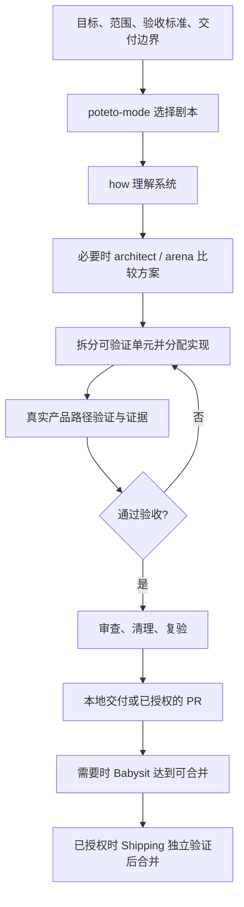

# pstack 从需求到验证交付的使用指南

研究日期：2026-10-22。以本机已安装的 pstack 0.2.2 为准，联网核对作者仓库。本文是研究结果和操作建议，本次没有配置验证技能、修改产品、创建 PR 或启动持续任务。

## 1. 先明确它提供了什么

pstack 是一套让编码代理选择并执行工作流的技能包。作者将其描述为独立移植版，并非 OpenAI 或 Cursor 官方包。本机包有 51 个技能目录和 23 个 playbook。日常总入口是 `poteto-mode`；`setup-pstack` 只管理模型偏好。[作者说明](https://github.com/mbokinala/pstack#readme)、[本机插件元数据](C:/Users/wjkao/.codex/plugins/cache/pstack/pstack/0.2.2/.codex-plugin/plugin.json)、[总入口](C:/Users/wjkao/.codex/plugins/cache/pstack/pstack/0.2.2/skills/poteto-mode/SKILL.md)。

完整使用不是每次串行运行全部技能，而是让总入口选择适当剧本，再按阶段调用辅助技能。项目若缺少运行环境或真实验证能力，仅安装技能不能填补这些缺口。[运行契约](C:/Users/wjkao/.codex/plugins/cache/pstack/pstack/0.2.2/skills/setup-pstack/references/pstack-runtime.md)。



这张图是本文对工作流的概括，不是插件内置的固定状态机。依据 [Feature](C:/Users/wjkao/.codex/plugins/cache/pstack/pstack/0.2.2/skills/poteto-mode/playbooks/feature.md)、[Opening a PR](C:/Users/wjkao/.codex/plugins/cache/pstack/pstack/0.2.2/skills/poteto-mode/playbooks/opening-a-pr.md)、[Shipping](C:/Users/wjkao/.codex/plugins/cache/pstack/pstack/0.2.2/skills/poteto-mode/playbooks/shipping.md)。

## 2. 如何调用和选择工作流

在 Codex 输入 `$` 并选择实际显示的技能。插件有命名空间时使用选择器里的 pstack 条目，避免与其他同名技能混用。作者文档使用 `$poteto-mode`，Claude Code / Cursor 使用 `/poteto-mode`。这些是聊天中的技能调用方式，不是终端命令。[作者用法](https://github.com/mbokinala/pstack#readme)。

如果当前聊天没有展示该技能，可开始新聊天刷新技能目录；若仍不可见，明确提供已安装的 SKILL.md 绝对路径，请代理读取它及相对引用后执行。不要因为名字没显示就重复叠加另一套安装。[作者安装说明](https://github.com/mbokinala/pstack#readme)、[运行契约](C:/Users/wjkao/.codex/plugins/cache/pstack/pstack/0.2.2/skills/setup-pstack/references/pstack-runtime.md)。

`poteto-mode` 的本机元数据设置 `allow_implicit_invocation: false`。因此新聊天应显式调用，不能认为装好插件或运行 setup 后就会自动长期启用。[调用策略](C:/Users/wjkao/.codex/plugins/cache/pstack/pstack/0.2.2/skills/poteto-mode/agents/openai.yaml)。

| 任务 | 使用入口或剧本 | 交付结果 |
|---|---|---|
| 新增功能 | poteto-mode → Feature | 已验证的功能 |
| 修 Bug | poteto-mode → Bug fix | 原问题复现、根因、修复及同路径复验 |
| 保持行为的改造 | Refactoring | 行为保持的结构变化 |
| 一次性能问题 | Perf issue | 基线与改进后的同指标证据 |
| 连续优化一个指标 | Hillclimb | 每轮假设、测量、接受或回退 |
| 探索交互或方案 | Prototype；必要时 architect / arena | 支持选择的可观察实验 |
| 不知道怎样拆的大任务 | figure-it-out | 先设计专属工作流，再按单元执行 |
| 一个任务持续做到验收 | Autonomous run | 明确完成条件及迭代证据 |
| 长期多任务项目 | Orchestrate | 队列、依赖、任务简报、验收台账 |
| 多个独立任务自动做到合并 | Autopilot-full | 每个 PR 有 owner，根协调者验证后合并 |
| 多个任务自动做成可审查 PR 链 | Autopilot-stack | 已验证的线性 PR 链，交给操作者合并 |
| 把 PR 跑到可合并 | Babysit | 评论和 CI 已处理，停在 merge-ready |
| 把已验证 PR 合并 | Shipping | 独立验证后，按依赖从底向上逐个合并 |
| 恢复中断任务 | Session pickup | 校验旧证据与当前 Git 状态后续跑 |

表中 Feature 等名称是 `poteto-mode/playbooks/` 的剧本，不必存在同名独立技能。路由与所有剧本见 [poteto-mode](C:/Users/wjkao/.codex/plugins/cache/pstack/pstack/0.2.2/skills/poteto-mode/SKILL.md)。所有独立技能的完整分类见 [技能目录](pstack-skill-catalog.md)。

## 3. 先建立真实验证闭环

最值得先运行的是 `create-verification-skill`。它通过读仓库确定怎么启动、怎么驱动、怎么观察、怎么隔离，并生成项目本地 `.agents/skills/verify-<app>/`，内含启动、健康检查、操作、证据和清理方法，以及最初 3–5 个用户功能地图。生成后必须亲自完整跑通至少一个功能，且清理后证据仍存在；没执行过只能叫草稿。[生成规则](C:/Users/wjkao/.codex/plugins/cache/pstack/pstack/0.2.2/skills/create-verification-skill/SKILL.md)。

适合 Wordbloom 的初始化请求：

```text
使用 pstack 的 create-verification-skill，为 Wordbloom 创建 verify-wordbloom。
先检查已有 tests 和浏览器能力，复用可用的 harness。
保持普通 JS、无构建框架的 Chrome MV3 扩展结构。
使用隔离测试 profile 和测试数据。
地图至少覆盖选词翻译/保存、列表编辑/搜索、阅读模式、设置导入导出、发音。
实际加载扩展，跑通一个完整用户路径，保存操作、可见结果及持久化证据。
不能用 mocked chrome API 的测试替代扩展运行证据。
如果当前工具无法加载/驱动真实扩展，明确报告 verifier-blocked 和具体缺口。
仅创建本地验证资料，不发布、不合并。
```

这里的功能范围是根据本仓库 manifest、源码和已有测试提出的建议，不是已经覆盖的声明。[manifest](../manifest.json)、[已有测试](../tests/)、[UI 验证规则](C:/Users/wjkao/.codex/plugins/cache/pstack/pstack/0.2.2/skills/control-ui/SKILL.md)。

完成验证基础后，日常运行匹配功能的路径即可。新功能改变入口或行为时，用 `maintain-verification-skill` 更新地图并真实重跑；维护技能只修改验证目录，遇到产品回归应报告，不能通过改文档掩盖。[维护规则](C:/Users/wjkao/.codex/plugins/cache/pstack/pstack/0.2.2/skills/maintain-verification-skill/SKILL.md)。

## 4. 一个功能怎样从头跑到底

推荐先用 Feature / Bug fix 加 Autonomous run 的纪律，而不是直接启动大型 Orchestrate。

1. 写可检查的完成条件，例如用户通过界面保存词条、刷新后仍存在、重复保存不会多一条。
2. `how` 理解受影响子系统。存在跨函数设计选择时用 `architect`，有值得比较的实现形态时用 `arena`。
3. 记录阻塞步骤、独立工作流、共享状态、最小合理拆分。并行写入必须有独占文件或独立工作树。
4. 实现代理收到目标、范围、验收条件和验证方法。主代理复查真实 diff。
5. 单元完成即验证；失败先查证据和假设，修复后再跑。Bug 的原始复现必须在同一产品表面复验。
6. 用 `deslop` 清理差异，`no-comments` 审查注释，必要时 `interrogate` 做独立挑战。其审查结果本身不会自动修代码，需要实现者处理并复验。
7. 根据已约定边界交付本地结果或 PR。长期任务维护 `show-me-your-work` 的 decisions.tsv。

依据 [Feature](C:/Users/wjkao/.codex/plugins/cache/pstack/pstack/0.2.2/skills/poteto-mode/playbooks/feature.md)、[Bug fix](C:/Users/wjkao/.codex/plugins/cache/pstack/pstack/0.2.2/skills/poteto-mode/playbooks/bug-fix.md)、[Autonomous run](C:/Users/wjkao/.codex/plugins/cache/pstack/pstack/0.2.2/skills/poteto-mode/playbooks/autonomous-run.md)、[Interrogate](C:/Users/wjkao/.codex/plugins/cache/pstack/pstack/0.2.2/skills/interrogate/SKILL.md)。

可复制的日常请求：

```text
使用 pstack 的 poteto-mode 完成下面的任务，并按 Autonomous run 持续推进。
目标：<用户可观察的功能或问题>。
验收：<操作、结果、持久化/错误路径要求>。
交付：本地已验证改动，不推送、不创建 PR、不合并。
先检查仓库和验证技能，选择匹配剧本，声明完成条件后执行。
有设计分歧时比较方案；按实际并发上限分派独立工作，主代理负责整合。
每个单元都要验证，失败则定位、修复、复验。
审查发现的问题由实现者处理，再更新证据。
普通可逆的实现选择自行决定；真正缺少产品决定或能力时具体说明。
在 .pstack/state/<task>/ 保存状态、决策和证据位置。
交付时列出完成条件、实际检查结果、未验证项及恢复入口。
```

## 5. PR 到合并是另一个明确的交付层级

本地闭环已经可以是完整 E2E。若目标还包括托管平台交付，则需实际可用的 PR 工具、认证、远端权限和验证环境。[Opening a PR](C:/Users/wjkao/.codex/plugins/cache/pstack/pstack/0.2.2/skills/poteto-mode/playbooks/opening-a-pr.md)。

```text
使用 pstack poteto-mode 实现 <目标>。
交付边界包括创建分支、推送和创建 PR。
完成后运行 Babysit drive，处理真实审查问题和 CI，直到 merge-ready。
我保留最终合并操作。
```

若要自动合并，在任务开始时明确增加 Shipping 的授权和验收要求。Babysit 的成功条件是可合并；它不会自行启动合并。Shipping 要求非实现者独立验证当前补丁，CI 绿灯或机器人赞同不足以替代该门槛。分支重写后需要检查 SHA、base 和 patch-id，不能拿旧证据覆盖新差异。[Babysit](C:/Users/wjkao/.codex/plugins/cache/pstack/pstack/0.2.2/skills/poteto-mode/playbooks/babysit.md)、[Shipping](C:/Users/wjkao/.codex/plugins/cache/pstack/pstack/0.2.2/skills/poteto-mode/playbooks/shipping.md)。

多 PR 计划有更严格的专用规范。`multi-phase-plan` 会先产出计划然后停下，明确 go 后才执行；其模板要求每 PR 的 unit/live/perf 验证、十个 live 场景及交互改动的操作者审查。这些要求不能误推广成所有小任务都要执行十轮。模板里示例的 `.agents/skills/...` 脚本路径，在插件安装模式下须解析成实际插件目录，不能照抄不存在的路径。[多阶段计划](C:/Users/wjkao/.codex/plugins/cache/pstack/pstack/0.2.2/skills/poteto-mode/playbooks/multi-phase-plan.md)。

## 6. 多任务、模型与连续运行

一个目标用 Autonomous run；大任务需要自定义方法用 figure-it-out；多个有依赖的长期工作单元才用 Orchestrate。Orchestrate 用任务简报、units、ledger、依赖表、inbox、状态与决策日志管理工作。其 `scripts/orch/orch.ts` 仅记账，不会启动代理、等待或调度。缺 Bun 可由单写者维护普通文件；只有特定 Graphite frontier 功能需要 gt，普通 Git/PR 工作流不要求安装 Graphite。[Orchestrate](C:/Users/wjkao/.codex/plugins/cache/pstack/pstack/0.2.2/skills/poteto-mode/playbooks/orchestrate.md)。

本项目 `.pstack/config.json` 为 `version: 1, roles: {}`，用户级配置不存在，角色模型全部继承父会话。配置契约没有角色级 reasoning effort 字段；不要写入自创字段假装会生效。确实需要努力程度偏好时，应在执行简报或个人模式中声明，并通过宿主实际支持的独立参数应用。当前宿主有原生代理和模型选择接口，但模型可用性要在每次执行时确认。[模型设置](../.pstack/config.json)、[运行契约](C:/Users/wjkao/.codex/plugins/cache/pstack/pstack/0.2.2/skills/setup-pstack/references/pstack-runtime.md)。

当前会话最多 4 个并发代理，含主代理，因此通常最多同时跑 3 个子代理。`interrogate` 默认 4 个 reviewer，应分批或按明确配置调整，不能越过宿主上限。同模型的独立上下文可以提供独立审查，但不能称为跨模型多样性。[Interrogate](C:/Users/wjkao/.codex/plugins/cache/pstack/pstack/0.2.2/skills/interrogate/SKILL.md)、[运行契约](C:/Users/wjkao/.codex/plugins/cache/pstack/pstack/0.2.2/skills/setup-pstack/references/pstack-runtime.md)；并发数来自本次会话的原生工具声明，可能随宿主变化。

技能本身不保证关闭应用后继续运行。需要定时唤醒时应另外使用宿主真实提供的自动化能力，并记录是否成功注册。仅运行 shell watcher 也不代表将来有代理接手。[Autonomous run](C:/Users/wjkao/.codex/plugins/cache/pstack/pstack/0.2.2/skills/poteto-mode/playbooks/autonomous-run.md)。

跨会话建议保存 `.pstack/state/<task>/`，下次这样请求：

```text
使用 pstack poteto-mode 的 Session pickup。
恢复 .pstack/state/<task>/ 中的目标和状态。
先核对工作树、当前提交与现有证据，不重复已验证且未变化的步骤。
继续原验收目标；若证据或代码变化则补做必要验证。
```

依据 [Session pickup](C:/Users/wjkao/.codex/plugins/cache/pstack/pstack/0.2.2/skills/poteto-mode/playbooks/session-pickup.md)。

`automate-me` 可以把明确的工作偏好沉淀为个人 mode 技能；它不会建立后台调度，也不会自动给新会话授予发布或合并权限。[Automate me](C:/Users/wjkao/.codex/plugins/cache/pstack/pstack/0.2.2/skills/automate-me/SKILL.md)。

## 7. Wordbloom 本次检查结果与建议顺序

| 检查项 | 本次结果 | 对闭环的影响 |
|---|---|---|
| pstack | 插件 0.2.2，51 技能、23 剧本 | 已有工作流资料 |
| 模型配置 | roles 为空 | 可直接继承，无须先挑所有角色模型 |
| Node / Git | PATH 可用 | 可运行已有测试、使用 Git |
| 行为测试 | 30/30 通过，0 skipped | 已有可复用的基线 |
| 浏览器测试 | content.test.cjs 实际启动 headless 浏览器，模拟 chrome API | 证明部分页面渲染，尚不能代表已加载真实扩展 |
| 项目验证技能 | .agents/skills 只有 show-me，未发现 verify-* | 优先补齐真实扩展验证配方 |
| gh / Origin CLI | PATH 未发现 | 内置剧本的默认 PR 操作尚不能直接执行 |
| Bun | PATH 未发现 | Orchestrate CLI 暂不能用，可采用文件记账 |
| gt | PATH 未发现 | 仅影响特定 Graphite 功能，不影响基础工作流 |
| 产品文档 | CLAUDE.md 写着没有测试，但 tests 已存在 | 不能只依赖旧文档判断项目能力 |

测试基线使用 PowerShell 执行：

```powershell
$testFiles = Get-ChildItem -LiteralPath 'C:\project\wordbook\tests' -Filter '*.test.cjs' |
  Select-Object -ExpandProperty FullName
& node --test @testFiles
```

本次结果为 30 tests、30 pass、0 fail、0 skipped。没有运行显式联网的 `tests/live-translation.cjs`，没有验证真实扩展安装路径、外部翻译/发音的全链路或远端 CI。测试范围见 [content.test.cjs](../tests/content.test.cjs)、[联网检查脚本](../tests/live-translation.cjs)、[项目指导](../CLAUDE.md)。

建议按此顺序推进：先补 verify-wordbloom 并真实试跑一次，再选一个小功能按 poteto-mode 做到本地验收，之后配置所需 PR 工具和认证，最后才扩展到 Babysit / Shipping 或多任务 Autopilot。先证明一条链路，再扩大并发和交付边界。
